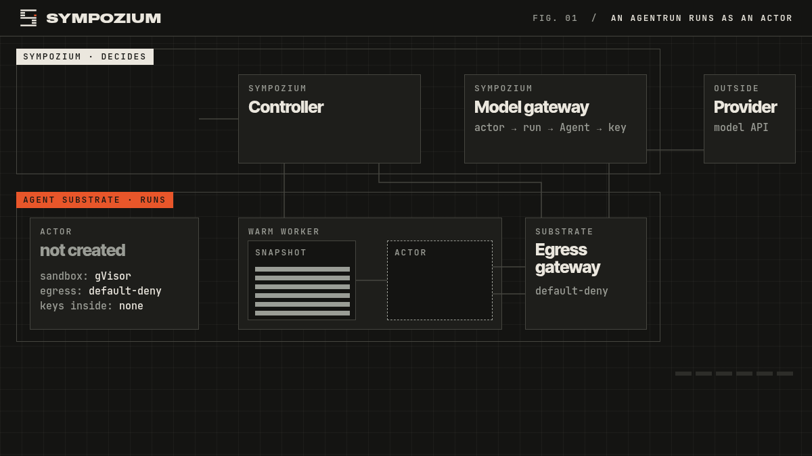
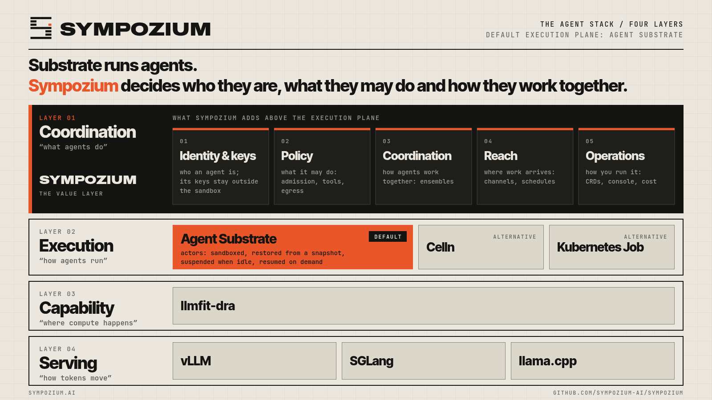
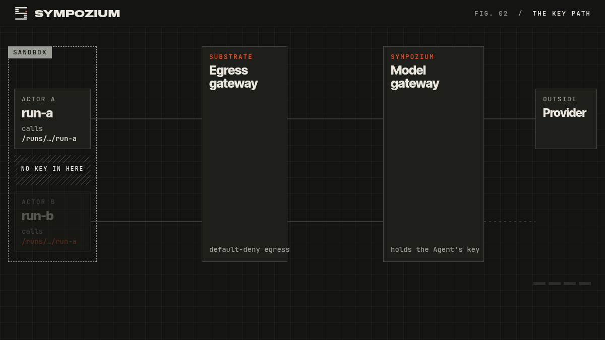
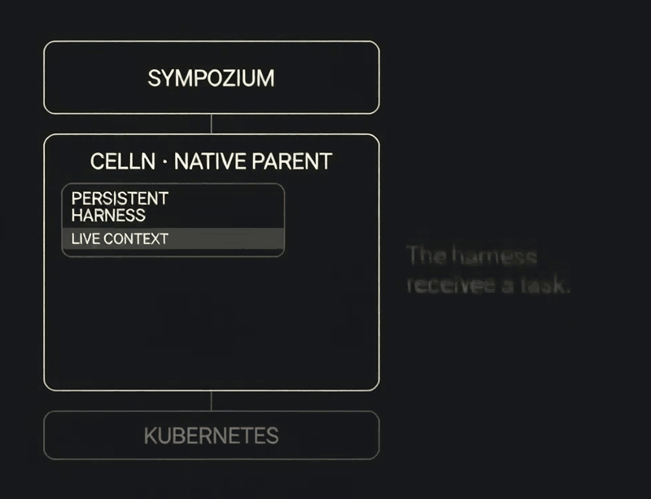

<p align="center">
  <picture>
    <source media="(prefers-color-scheme: dark)" srcset="docs/assets/brand/logo-plate-dark.svg">
    
  </picture>
</p>

<p align="center">

  <em>
  Agents don't need better prompts. They need shared situational awareness.<br>
  Sympozium is a <b>coordination layer</b> for multi-agent AI systems on Kubernetes &mdash;<br>
  identity and keys, policy, coordination, reach and operations<br>
  above an execution plane it does not have to build.<br>
  Agents run as <a href="https://github.com/agent-substrate/substrate">Agent Substrate</a> actors by default. Every policy is a CRD.</em><br><br>
  From the creator of <a href="https://github.com/k8sgpt-ai/k8sgpt">k8sgpt</a> and <a href="https://github.com/AlexsJones/llmfit">llmfit</a>
</p>

<p align="center">
  <b>
  This project is under active development. API's will change, things will break. Be brave.
  <b />
</p>
<p align="center">
  <a href="https://github.com/sympozium-ai/sympozium/actions"></a>
  <a href="https://github.com/sympozium-ai/sympozium/releases/latest"></a>
  <a href="LICENSE"></a>
</p>

<p align="center">
  
</p>
<p align="center">
  <b>Sympozium decides. Substrate executes.</b><br>
  <sub>An AgentRun as an Agent Substrate actor: admitted by Sympozium, run in a sandbox that never holds the Agent's key.<br>
  Measured 2026-11-22 on one node with a stub model: 0.43 s from created to succeeded, against 11.3 s as a Kubernetes Job (median of 20 runs each).
  <a href="docs/evidence/substrate-spike-go-no-go-2026-11-22.md">Method and raw data</a>.</sub>
</p>

<!-- STATUS:substrate -->
> [!WARNING]
> **State of the Substrate backend, 2026-11-24.** Agent Substrate is the
> default execution plane by decision of 2026-11-24. The implementation is
> on a branch and not released. Where Substrate is installed and enabled
> (chart value `substrate.enabled`), a run that names no backend runs as an
> actor when it can: a one-shot string task with a model key, with channel
> messages and schedules served outside the sandbox under the run's tool
> policy. A run that needs skills, MCP servers, memory, delegation or an
> enduring conversation runs as a Kubernetes Job instead, and its
> `DefaultExecutionPlane` condition says why. A plain `sympozium install`
> does not install Substrate, so there every run is a Job. One in-cluster
> hop, from Substrate's egress gateway to the model gateway, is unencrypted.
> See [Substrate backend](docs/concepts/substrate-backend.md).

---

> **Full documentation:** [deploy.sympozium.ai/docs](https://deploy.sympozium.ai/docs/)

---

> [!IMPORTANT]
> **AgentHarness is available experimentally.** Run an administrator-approved
> external adapter in an isolated AgentRun, or choose a session-capable runtime
> for a private, continuing **Agent → Chat** conversation. Kubernetes policy,
> identity, skills, memory, MCP, observability, and audit remain under platform
> control. Start with the [AgentHarness guide](https://deploy.sympozium.ai/docs/guides/agentharness/)
> and the digest-pinned [reference adapter](examples/harness-reference/). This
> is an adapter boundary—not permission to run arbitrary upstream images.

---

### Quick Install (macOS / Linux)

**Homebrew:**
```bash
brew tap sympozium-ai/sympozium
brew install sympozium
```

**Shell installer:**
```bash
curl -fsSL https://deploy.sympozium.ai/install.sh | sh
```

Then deploy to your cluster and activate your first agents:

```bash
sympozium install          # deploys CRDs, the control plane, built-in Ensembles and ergoz; nothing about models is asked
sympozium                  # launch the TUI — go to Ensembles tab, press Enter to onboard
sympozium serve            # open the web dashboard (port-forwards to the in-cluster UI)
```

A plain install needs nothing else on the cluster: Agents run as Kubernetes
Jobs. The other two execution backends are added separately.

- **Agent Substrate** is installed from
  [its own project](https://github.com/agent-substrate/substrate);
  `sympozium install` does not install it. See the
  [Substrate backend](docs/concepts/substrate-backend.md) page for the
  current state.
- **Celln**, the self-hosted option, is one flag:

```bash
sympozium install --celln-fleet   # also the Celln fleet and the model gateway
```

The fleet runs hardware-isolated, one-shot and long-running agents for every
namespace on every node with KVM. Its two DaemonSets are privileged (booting
micro-VMs needs `/dev/kvm`, `/boot` and `/lib/modules`) and the install says
so first. Each Agent brings its own `ModelConnection` and key; the gateway
adds the key per call and no node ever holds it.

The Celln fleet runs on nodes that have `/dev/kvm` and a kernel image under
`/boot` (each cell is a microVM; the VMM boots it from that file); the node
probe labels such nodes `celln.dev/kvm=true`. **Kind is a development
environment only.** On a Linux host, Kind nodes already see `/dev/kvm` but
ship without a kernel image, so a `--celln-fleet` install waits for a node
that never qualifies. The mitigation is to copy the host's running kernel
into each node; the probe labels it within seconds:

```bash
docker cp /boot/vmlinuz-$(uname -r) kind-control-plane:/boot/   # and each worker
```

Kind on macOS or Windows runs inside a VM without `/dev/kvm` and cannot run
the fleet at all. The installer prints this hint if no node has qualified
within the first minute of its wait.

### Advanced: Helm Chart

**Prerequisites:** [cert-manager](https://cert-manager.io/) (for webhook TLS):
```bash
kubectl apply -f https://github.com/cert-manager/cert-manager/releases/download/v1.17.1/cert-manager.yaml
```

Sympozium can be installed as two charts: `sympozium-crds` (the CRDs, so they can be upgraded) and `sympozium` (the control plane). Install the CRDs first, then the control plane:

```bash
helm repo add sympozium https://deploy.sympozium.ai/charts
helm repo update

helm upgrade --install sympozium-crds sympozium/sympozium-crds \
  --namespace sympozium-system --create-namespace

helm upgrade --install sympozium sympozium/sympozium \
  --namespace sympozium-system \
  --skip-crds --set createNamespace=false
```

> `--skip-crds` on the second command assumes you installed `sympozium-crds`
> first. If you skip the CRDs chart, drop `--skip-crds` so the bundled CRDs
> in the `sympozium` chart are applied instead.

See [`charts/sympozium/values.yaml`](charts/sympozium/values.yaml) for configuration options, or the [Helm Chart docs](https://deploy.sympozium.ai/docs/reference/helm/) for the full guide.

---

## What is Sympozium?

Containers needed orchestration. Agents need coordination.

Sympozium is a **Kubernetes-native coordination layer** for multi-agent AI systems. It does not run agents itself. It sits above an execution plane &mdash; [Agent Substrate](https://github.com/agent-substrate/substrate) by default &mdash; and adds the five things an execution plane does not have:

| | What Sympozium adds |
|---|---|
| **Identity and keys** | Each `Agent` owns its provider, its model and its key. On Substrate and Celln the key is added to each model call by a gateway outside the sandbox, and the agent never holds it (a Job receives it in its pod environment) |
| **Policy** | `SympoziumPolicy`, per-tool allow and deny, and admission checks, enforced before a run starts and never by the agent itself |
| **Coordination** | Ensembles, delegation between agents, a membrane that controls what they share, and shared memory |
| **Reach** | Chat channels, cron schedules, and an OpenAI-compatible API in front of every Agent |
| **Operations** | Every resource is a CRD under your RBAC and GitOps; a web console, TUI and CLI; token usage and cost on every run |

An execution plane on its own gives you a sandbox with a name. It does not know what an Agent is, whose key a model call should carry, which tools are allowed, or that two runs belong to the same team. That is the layer Sympozium is.

### Architecture in one picture

<p align="center">
  
</p>

Four layers, one question each:

| Layer | Who | Decides |
|---|---|---|
| **Coordination** | Sympozium | What agents **do** |
| **Execution** | [Agent Substrate](docs/concepts/substrate-backend.md) by default; [Celln](docs/concepts/celln-backend.md) or a Kubernetes Job as alternatives | How agents **run** |
| **Capability** | [llmfit-dra](https://github.com/sympozium-ai/llmfit-dra) | Where compute **happens** |
| **Serving** | vLLM, SGLang, llama.cpp | How tokens **move** |

An `AgentRun` is a Kubernetes object. The controller admits it (policy, key ownership), then hands it to an execution backend, which only has to start the run, report on it and release it. On Substrate and Celln, model calls leave the sandbox without a key and pick one up at the model gateway. When an agent needs a model served in the cluster, Sympozium *claims* one the way an application claims a PersistentVolume &mdash; it never decides where it runs. See [Positioning](https://deploy.sympozium.ai/docs/positioning/) for the boundary and what is deliberately out of scope.

<p align="center">
  
  <br><em>Substrate says which actor is calling. Sympozium says whose key that is.</em>
</p>

### Execution backends

| Backend | A run is | Choose it when |
|---|---|---|
| **Agent Substrate** (default) | An actor: a gVisor sandbox restored from a memory snapshot, suspendable when idle | You want fast starts and a key that never enters the sandbox |
| **Celln** | A KVM microVM cell | You want a self-hosted execution plane with no external dependency, or hardware isolation |
| **Kubernetes Job** | A Pod | You want nothing extra installed |

Celln and the Job are not going away. Celln is the option that depends on nothing outside your cluster; the Job is the one that needs nothing installed at all.

<p align="center">
  <a href="https://sympozium.ai/video/sympozium-harness-tasks.mp4">
    
  </a>
  <br><sub>The Celln backend: the harness stays, the task cell goes. One active task at a time; live context does not survive a host crash.
  <a href="https://github.com/sympozium-ai/sympozium/discussions/472">Native cells release</a>.</sub>
</p>

Evaluating Google's [AX](https://github.com/google/ax) or Agent Substrate on their own? Read [Sympozium vs Google AX](https://deploy.sympozium.ai/docs/sympozium-vs-google-ax/), an honest comparison of what each layer gives you, where they are ahead, and how they fit together.

### Agent Coordination

| | |
|---|---|
| **Synthetic Membrane** | Selective permeability for agent teams &mdash; control what agents share via trust groups, visibility tags, and field-level gating. [Read the paper](https://zenodo.org/records/20070699) |
| **Agent Workflows** | Delegation, sequential pipelines, supervision, and stimulus triggers between personas &mdash; visualised on an interactive canvas |
| **Shared Workflow Memory** | Pack-level SQLite memory pool for cross-persona knowledge sharing with per-persona access control and time decay |
| **Ensembles** | Helm-like bundles for AI agent teams &mdash; activate a pack and the controller stamps out Agents, Schedules, and memory |

### Platform Infrastructure

| | |
|---|---|
| **Model Endpoints for Agents** | Declare models as CRDs &mdash; GGUF or HuggingFace weights are downloaded, an inference server (llama.cpp, vLLM, TGI, or custom) is deployed, and OpenAI-compatible endpoints are exposed for your personas. No API keys required. Placement is *claimed*, not decided here: with [llmfit-dra](https://github.com/sympozium-ai/llmfit-dra) installed, the stock scheduler places models by physics |
| **Skill Sidecars** | On the Job backend, every skill runs in its own sidecar with ephemeral least-privilege RBAC, garbage-collected on completion |
| **Multi-Channel** | Telegram, Slack, Discord, WhatsApp &mdash; each channel is a dedicated Deployment backed by NATS JetStream |
| **Persistent Memory** | SQLite + FTS5 on a PersistentVolume &mdash; memories survive across runs |
| **Scheduled Tasks** | Cron-based recurring agent runs for periodic workflows, data syncs, and automated checks |
| **Agent Sandbox** | Kernel-level isolation via [kubernetes-sigs/agent-sandbox](https://deploy.sympozium.ai/docs/concepts/agent-sandbox/) &mdash; gVisor or Kata with warm pools for instant starts |
| **MCP Servers** | External tool providers via Model Context Protocol with auto-discovery and allow/deny filtering |
| **TUI & Web UI** | Terminal and browser dashboards with live workflow canvas, or skip the UI entirely with Helm and kubectl |
| **Policy & Governance** | `SympoziumPolicy` CRD &mdash; tool gating (allow/deny, enforced on every run), sandbox requirements, network egress rules, image-registry allowlists, and whether skills may touch Secrets |
| **One Key per Agent** | Every Agent uses its own model key; only its sub-agents share it. The key's owner is recorded on its Secret and checked by the controller, the admission webhook and, on every call, the model gateway. Skills cannot read Secrets or start pods that do unless a policy allows it. See [Security](https://deploy.sympozium.ai/docs/concepts/security/#model-keys) |
| **Agent-Bound Model Access** | Celln holds no model. Each Agent's `ModelConnection` (any OpenAI- or Anthropic-compatible endpoint) is its route; its key is owned by that Agent, pinned to that endpoint's origin, and added per call by a model gateway that re-checks everything on every request. Operators may narrow destinations by host pattern and approve private endpoints once. See the [model access guide](https://deploy.sympozium.ai/docs/guides/celln-mediated-model-access/) |
| **Every Agent is an OpenAI Endpoint** | Point any OpenAI SDK at `/api/v1/agents/{name}/v1` with your Sympozium token: the newest user message reaches the Agent's own conversation (a Celln cell, or a Pi/Hermes session) and the answer comes back as a chat completion, streaming included. See the [model access guide](https://deploy.sympozium.ai/docs/guides/celln-mediated-model-access/) |
| **Serving Mode** | Run an agent as a long-lived, OpenAI-compatible + MCP HTTP endpoint instead of a one-shot Job &mdash; agents as services |
| **Observability & Cost** | OpenTelemetry traces and metrics, Prometheus endpoints, per-run trace IDs, and token usage with estimated cost on every AgentRun |
| **Celln Tool Catalogue** | Hardware-isolated agents borrow real programs (grep, sed, awk, jq, &hellip;) taken from container images pinned by digest, never reimplemented. Every borrowed tool names the image layer it came from, and operators extend the toolbox by adding an image to the catalogue, no rebuild. See [the fleet guide](docs/guides/celln-fleet-installation.md#the-toolbox) |
| **Any AI Provider** | OpenAI, Anthropic, xAI (Grok), AWS Bedrock, Azure, Ollama, or any OpenAI-compatible endpoint (Groq, Mistral, DeepSeek, OpenRouter, vLLM, LM Studio, &hellip;) &mdash; no vendor lock-in |

---

## Documentation

| Topic | Link |
|-------|------|
| Getting Started | [deploy.sympozium.ai/docs/getting-started](https://deploy.sympozium.ai/docs/getting-started/) |
| Positioning &mdash; what Sympozium is (and isn't) | [deploy.sympozium.ai/docs/positioning](https://deploy.sympozium.ai/docs/positioning/) |
| Sympozium vs Google AX &amp; Agent Substrate &mdash; an honest comparison | [deploy.sympozium.ai/docs/sympozium-vs-google-ax](https://deploy.sympozium.ai/docs/sympozium-vs-google-ax/) |
| Architecture | [deploy.sympozium.ai/docs/architecture](https://deploy.sympozium.ai/docs/architecture/) |
| Custom Resources | [deploy.sympozium.ai/docs/concepts/custom-resources](https://deploy.sympozium.ai/docs/concepts/custom-resources/) |
| Ensembles | [deploy.sympozium.ai/docs/concepts/ensembles](https://deploy.sympozium.ai/docs/concepts/ensembles/) |
| Skills & Sidecars | [deploy.sympozium.ai/docs/concepts/skills](https://deploy.sympozium.ai/docs/concepts/skills/) |
| Sidecar-Driven Mode | [deploy.sympozium.ai/docs/modes/sidecar-driven](https://deploy.sympozium.ai/docs/modes/sidecar-driven/) |
| Harness Mode (external agent harnesses) | [deploy.sympozium.ai/docs/modes/harness](https://deploy.sympozium.ai/docs/modes/harness/) |
| Persistent Memory | [deploy.sympozium.ai/docs/concepts/persistent-memory](https://deploy.sympozium.ai/docs/concepts/persistent-memory/) |
| Channels | [deploy.sympozium.ai/docs/concepts/channels](https://deploy.sympozium.ai/docs/concepts/channels/) |
| Agent Sandboxing | [deploy.sympozium.ai/docs/concepts/agent-sandbox](https://deploy.sympozium.ai/docs/concepts/agent-sandbox/) |
| Substrate Backend (the default execution plane) | [deploy.sympozium.ai/docs/concepts/substrate-backend](https://deploy.sympozium.ai/docs/concepts/substrate-backend/) |
| Hermetic Workloads (Celln) | [deploy.sympozium.ai/docs/concepts/celln-backend](https://deploy.sympozium.ai/docs/concepts/celln-backend/) |
| Security | [deploy.sympozium.ai/docs/concepts/security](https://deploy.sympozium.ai/docs/concepts/security/) |
| Agent-bound Model Access (connections, keys, gateway) | [deploy.sympozium.ai/docs/guides/celln-mediated-model-access](https://deploy.sympozium.ai/docs/guides/celln-mediated-model-access/) |
| Celln Fleet Installation | [deploy.sympozium.ai/docs/guides/celln-fleet-installation](https://deploy.sympozium.ai/docs/guides/celln-fleet-installation/) |
| CLI & TUI Reference | [deploy.sympozium.ai/docs/reference/cli](https://deploy.sympozium.ai/docs/reference/cli/) |
| Helm Chart | [deploy.sympozium.ai/docs/reference/helm](https://deploy.sympozium.ai/docs/reference/helm/) |
| Local Models | [deploy.sympozium.ai/docs/guides/local-models](https://deploy.sympozium.ai/docs/guides/local-models/) |
| Ollama & Local Inference | [deploy.sympozium.ai/docs/guides/ollama](https://deploy.sympozium.ai/docs/guides/ollama/) |
| Writing Skills | [deploy.sympozium.ai/docs/guides/writing-skills](https://deploy.sympozium.ai/docs/guides/writing-skills/) |
| Writing Tools | [deploy.sympozium.ai/docs/guides/writing-tools](https://deploy.sympozium.ai/docs/guides/writing-tools/) |
| Writing Orchestrator Sidecars | [deploy.sympozium.ai/docs/sidecars/writing-orchestrator-sidecars](https://deploy.sympozium.ai/docs/sidecars/writing-orchestrator-sidecars/) |
| LM Studio & Local Inference | [deploy.sympozium.ai/docs/guides/lm-studio](https://deploy.sympozium.ai/docs/guides/lm-studio/) |
| llama-server | [deploy.sympozium.ai/docs/guides/llama-server](https://deploy.sympozium.ai/docs/guides/llama-server/) |
| Unsloth | [deploy.sympozium.ai/docs/guides/unsloth](https://deploy.sympozium.ai/docs/guides/unsloth/) |
| Writing Ensembles | [deploy.sympozium.ai/docs/guides/writing-ensembles](https://deploy.sympozium.ai/docs/guides/writing-ensembles/) |
| Your First AgentRun | [deploy.sympozium.ai/docs/guides/first-agentrun](https://deploy.sympozium.ai/docs/guides/first-agentrun/) |
| Adding a Task Mode | [deploy.sympozium.ai/docs/modes/extension-guide](https://deploy.sympozium.ai/docs/modes/extension-guide/) |

---

## Development

```bash
make test        # run tests
make test-system # run envtest system tests (no cluster needed)
make lint        # run linter
make manifests   # generate CRD manifests
make run-controller # run controller locally (needs kubeconfig)
```

## License

MIT License
