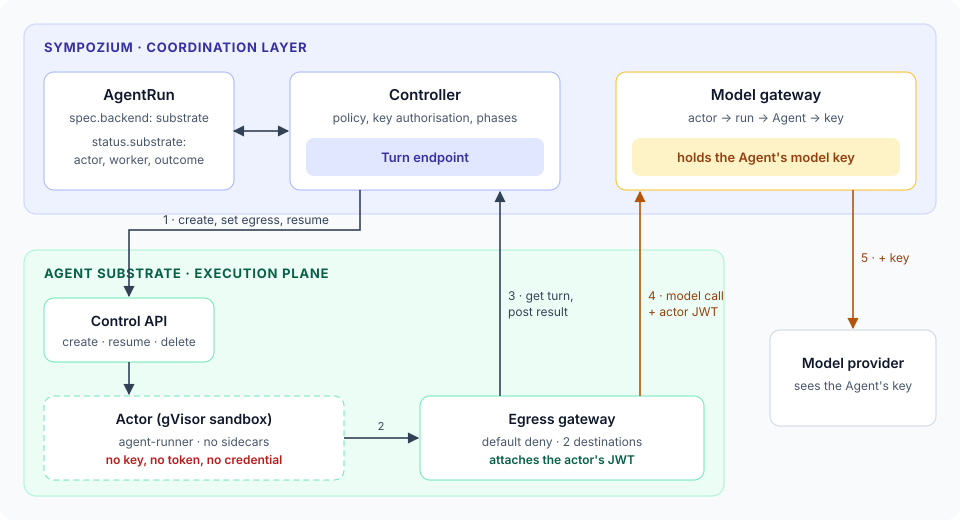
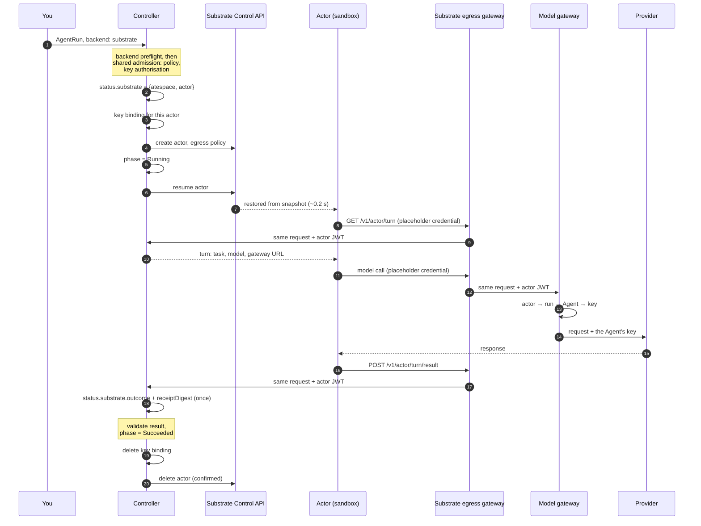
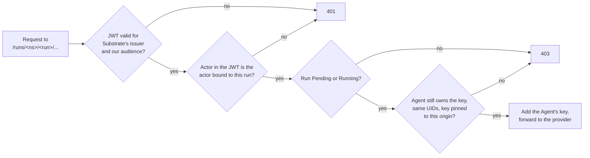
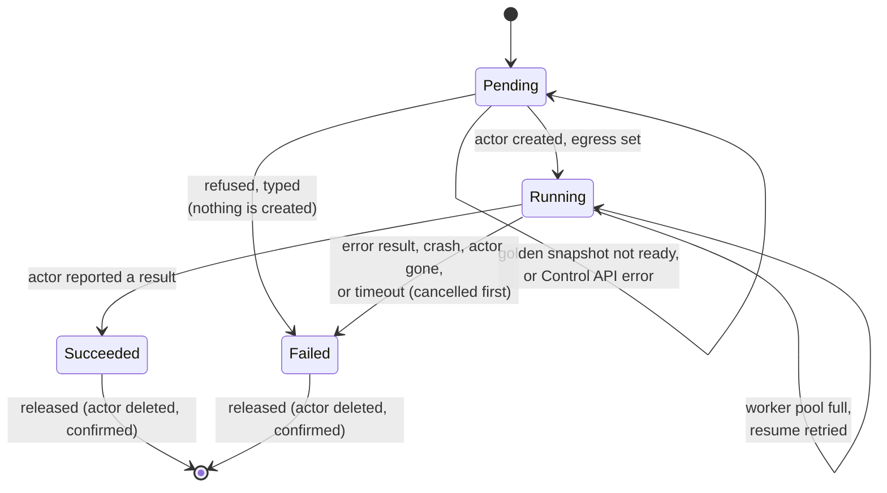

# Substrate backend: an AgentRun as an Agent Substrate actor

Status: **experimental, opt-in, not enabled by default.** Part of
[epic #692](https://github.com/sympozium-ai/sympozium/issues/692), tracked in
[#699](https://github.com/sympozium-ai/sympozium/issues/699). It started as a
spike on 2026-11-22; the measurements and the go/no-go from that spike are in
the [evidence note](../evidence/substrate-spike-go-no-go-2026-11-22.md).

`spec.backend: substrate` runs an `AgentRun` inside an
[Agent Substrate](https://github.com/agent-substrate/substrate) actor instead
of a Kubernetes Job. Sympozium still decides everything about the run (which
Agent, which key, which policy, what the result means). Substrate only
executes it, in a gVisor sandbox that starts from a memory snapshot in about
0.2 s.



## It is opt-in twice

Nothing uses this backend unless both of these are true.

1. **The operator configured it.** The chart's `substrate.enabled` is `false`
   by default, and with default values the chart renders exactly what it
   rendered before this backend existed. Enabling it also requires an explicit
   acknowledgement of the [clear-text hop](#the-clear-text-hop).
2. **The run asks for it.** Only `spec.backend: substrate` selects the
   backend. A controller configured for Substrate takes no other run: a run
   with no `backend`, `backend: job` or `backend: celln` executes exactly
   where it did before. Whether Substrate is installed on the cluster is never
   looked at, so installing it changes nothing.

A run that asks for Substrate where it cannot be had is **refused with a typed
code**. It is never run as a Job instead.

Nothing here touches Celln: its defaults, its code paths and its chart values
are unchanged.

## What you get

| | Job backend | Substrate backend |
|---|---|---|
| Start to result, model stubbed out | about 11 s | about 0.4 s |
| Where the Agent's model key is | in the pod's environment | never in the sandbox |
| What the sandbox can reach | whatever the pod network allows | the turn endpoint and the model gateway, nothing else |
| Sidecars | ipc-bridge, plus skills and MCP | none |
| Idle cost | a pod | a suspended actor: no process memory, about 0.6 MB of storage |

The numbers are from one node; see the evidence note for how they were taken.

## What it does not do yet

The backend supports one shape of run and refuses anything else, before it
creates anything, with `SUBSTRATE_UNSUPPORTED_RUN` (see
[Refusals](#refusals-are-typed)).

- **One-shot string tasks only.** No harness runtimes or task modes, lifecycle
  hooks, gates, `spec.env`, `spec.volumes`, enduring runs or server mode.
- **A model key is required.** `spec.model.authSecretRef` must be set; a run
  with `modelRef` or `connectionRef` is refused.
- **No tools.** A run or an Agent with skills or MCP servers is refused. See
  [Tools](#tools-are-the-open-design-question).
- **No memory.**
- **Run names must be DNS labels** of at most 63 characters, because the run
  name is the actor name.

## How a run executes



Four things in that sequence are worth understanding.

### The actor pulls its work

An actor is restored from a *golden snapshot*: the memory of a process that
was started once per runner image and frozen. Every run of that image resumes
from the same frozen process, so nothing about a run can arrive through the
environment or a file at start. An actor also has no sidecars, so there is no
ipc-bridge to hand the task over.

Instead the runner starts in a new mode, `agent-runner actor`. It serves a
health check and loops, asking the controller's turn endpoint for work.
While the actor is suspended nothing runs. Once resumed, the next request is
answered with the run's turn: an ID and the environment the ordinary runner
needs. The runner runs the turn as a child process and posts the result back.

### Nothing in the sandbox identifies it

The runner sends a fixed placeholder, `Bearer substrate-actor`, where a
credential would go. Substrate's egress gateway replaces that header, after
the request has left the sandbox, with a short-lived JWT that names the
actor. The receiver verifies the JWT against Substrate's issuer.

So the sandbox holds no key, no token and no certificate, and it cannot claim
to be another actor: it never sees the JWT. A request that arrives with the
placeholder unreplaced is refused.

### The run is bound to one actor before the actor exists

The controller writes `status.substrate` (`atespace`, `actor`) before it
creates anything. The atespace is the run's namespace and the actor is the
run's name, so the actor's identity (`actor/<namespace>/<run>`) leads
straight to the run with no lookup table. The turn endpoint then checks that
the run's status names that actor, with that actor's UID, before handing
over the turn. An actor deleted and created again under the same name is not
the run's actor. The API server refuses a status update that would move a run
to another actor.

### The key is added outside the sandbox

The controller records, in a Secret owned by the run, which actor may use
the run's key and what the key was bound to when the run started: the
Agent's UID, the key Secret's UID and the provider origin. That Secret holds
no token. The model gateway reads it on every call:



The path names the run, but the path is chosen by the caller. What decides
is the binding the controller wrote. An actor that calls another run's path
gets a 401, which is what a wrong token gets.

These are the checks every gateway-mediated run passes, and the same code
makes them:

- The key goes only to the upstream of the **operator's profile** for the
  run's provider. A run whose `spec.model.baseURL` points anywhere else is
  refused (`MODEL_KEY_ORIGIN_MISMATCH`) before an actor exists.
- The controller **pins** the key to that origin when it writes the binding.
  A key already pinned to another origin is refused
  (`MODEL_KEY_ORIGIN_MISMATCH`), and keeps its pin.
- The gateway re-checks, on every call, that the Agent still grants and owns
  the key, that the Agent and the key Secret still have the UIDs recorded at
  start, and that the key is still pinned to the profile's origin. A key that
  loses its pin, or is pinned elsewhere, mid-run stops the actor with a 403.

A Substrate run exposes the key to less than a Job run does: the Job backend
puts the key in the pod's environment, and here it never leaves the gateway.

When the run ends, or is cancelled, the binding is deleted before the actor
is, so a slow delete cannot leave an actor that still reaches a key.

## Where the code is

| Piece | File |
|---|---|
| The backend (`Preflight`, `Start`, `Observe`, `Cancel`, `Release`), the turn store, the key binding, the receipt | `internal/controller/substrate_backend.go` |
| Backend selection, typed refusal codes, the optional `Preflight` and `Cancel` parts of the seam | `internal/controller/execution_backend.go` |
| Control API client | `internal/substrate/client.go` |
| Turn endpoint and actor JWT verification | `internal/substrate/turns.go` |
| Settings shared by the controller and the gateway | `internal/substrate/settings.go` |
| Actor-bound runs in the gateway | `internal/harnessgateway/gateway.go` (`ActorAnnotation`, `ActorHandler`) |
| Runner actor mode | `cmd/agent-runner/actor.go` |
| Chart wiring | `charts/sympozium/values.yaml` (`substrate:`), `templates/substrate.yaml`, and the controller and gateway templates |
| Substrate's API, vendored | `third_party/substrate/` |
| Unit tests of the contract, with a counting fake Control API | `internal/controller/substrate_backend_test.go` |
| System tests against a real API server and a fake Control API | `test/system/substrate_test.go` |

Substrate's Go module cannot be imported: it needs newer Kubernetes
libraries and a newer Go than this repository uses. Its API definition is
vendored instead, pinned to a tag with checksums. `make vet` fails if the
copy drifts. To move to another tag:

```sh
hack/vendor-substrate-api.sh <tag> <path-to-substrate-checkout>
```

### How it sits behind the seam

The backend implements `ExecutionBackend`
([the seam](execution-backend-seam.md)). The reconciler gained no Substrate
branch. It asks the backend set which backend owns the run, and calls that
backend's `Start` or `Observe`. Adding another backend is one more entry in
that list.

The backend keeps no state in memory. The run's status says which actor it
is, the turn is derived from the run on every request, and the result is
written to status by whichever controller replica the actor reached. The
turn endpoint therefore runs on every replica, not only the leader.

How it meets the seam's contract:

| Contract | How |
|---|---|
| **Refusals are typed results** | Every refusal ends the run with `Phase() == Refused` and a `RefusalCode` readable through `Result().PublicReason`. The code is a condition (`ExecutionAdmitted=False`, reason = the code) written by `failRun` in the same status update as `Failed`, the pattern `ModelKeyAuthorized` uses. A refused run has no `status.substrate`, no actor, no key binding, no pin on its key and no Job. |
| **Start is idempotent** | "Attempted" (`status.substrate`) is persisted before the first Control API call, and the actor name is the idempotency key for every call after it. A replay (a Control API error between steps, a stale cache, a conflict, a restart) gets the same actor, sets the same egress policy on it and keeps the same key binding. A `Start` replayed from a stale copy of a run that is already Running or finished makes no Control API call at all. |
| **The receipt is write-once** | The actor's outcome and `status.substrate.receiptDigest` are written in one status update, once. The digest covers the run UID, the actor (by UID), the exit code, the result and when it arrived. A second result post is refused (HTTP 409), and the API server refuses any later change to the digest (a CEL rule on the CRD). `Result().Receipt` returns it. |
| **Cancel is separate from Release** | `Cancel` stops the work; `Release` cleans up, is confirmed by the Control API, is idempotent and does not need `Cancel` to have run. See [Lifecycle](#lifecycle-and-failure-handling). |

### Treating the sandbox as hostile

Everything the actor sends is written by an LLM-driven process.

- A request body is capped at 5 MiB.
- A result is accepted only from the run's own actor, for the run's own UID,
  while the run is Running, and only once. A second post, identical or not,
  is refused and changes nothing.
- A result document over 256 KiB, or one that is not valid JSON, is dropped.
- The result is interpreted by the same function that reads a Job pod's
  result, which clamps agent-reported token counts.
- The log tail is cut to 256 KiB and stored in a ConfigMap owned by the run.
- The turn the actor is handed carries a placeholder where a key would go and
  nothing read from a Secret.

## Configuration

### Chart values

Everything is under `substrate:` in `charts/sympozium/values.yaml`. With
`enabled: false` (the default) none of it renders.

| Value | Default | Meaning |
|---|---|---|
| `substrate.enabled` | `false` | Wire the controller and the model gateway to a Substrate install. Needs `harnessGateway.enabled`; the chart fails to render without it. |
| `substrate.allowPlaintextGatewayHop` | `false` | The acknowledgement of [the clear-text hop](#the-clear-text-hop). While `false`, every run is refused and no listener, Service or NetworkPolicy rule for actors exists. |
| `substrate.runnerImage` | `""` | agent-runner image actors run. Required, and must be pinned by digest. |
| `substrate.controlAPI.endpoint` | `""` | Control API `host:port`. Required. |
| `substrate.controlAPI.serverName` | `""` | Name in the Control API's certificate, if it differs from the host. |
| `substrate.controlAPI.tokenAudience` | `""` | Audience of the projected ServiceAccount token the controller presents. Required. |
| `substrate.controlAPI.tokenExpirationSeconds` | `3600` | Lifetime of that token. |
| `substrate.jwt.issuer` | `""` | Issuer of actor JWTs. Required. |
| `substrate.jwt.jwksURL` | `""` | Key set URL. Empty means `<issuer>/openid/v1/jwks`. |
| `substrate.jwt.jwksServerName` | `""` | Name in the key set server's certificate, if it differs. |
| `substrate.jwt.audience` | `sympozium` | Audience actor JWTs are minted for and checked against. |
| `substrate.ca.configMap`, `substrate.ca.key` | `""`, `ca.crt` | ConfigMap in the Sympozium namespace with the CA bundle for Substrate's own serving certificates. Required. |
| `substrate.turnEndpoint.port` | `8090` | Port of the controller's turn endpoint. |
| `substrate.gateway.port` | `8080` | Port of the model gateway's listener for actors. |
| `substrate.egressGateway.namespace`, `.podSelector` | `ate-system`, `{}` | Where Substrate's egress gateway runs: the only source the gateway's NetworkPolicy admits on the actor port. |

When enabled, the chart:

- sets the `SUBSTRATE_*` variables below on the controller and the model
  gateway, from the same values, so the two cannot disagree about the issuer
  or the audience;
- mounts the CA bundle into both, and into the controller a **projected
  ServiceAccount token** with its own audience for the Control API (the
  controller re-reads it on every call, so rotation needs no restart);
- when the hop is acknowledged, adds a Service for the turn endpoint
  (`sympozium-substrate-turns`), an `actors` port on the gateway's Service,
  and a NetworkPolicy rule that admits only Substrate's egress gateway
  namespace on it.

Substrate itself is not installed by this chart, and it must be told to
accept the controller's ServiceAccount (`sympozium-controller-manager`) for
the token audience you choose.

### Variables

The controller and the gateway read the same variables. Substrate is
configured when `SUBSTRATE_JWT_ISSUER` is set.

| Variable | Read by | Meaning |
|---|---|---|
| `SUBSTRATE_JWT_ISSUER` | both | Issuer of actor JWTs, for example `https://idp.ate-system.svc` |
| `SUBSTRATE_JWKS_URL` | both | Key set URL, `https` only. Default: `<issuer>/openid/v1/jwks` |
| `SUBSTRATE_JWKS_SERVER_NAME` | both | Name in the key set server's certificate, if it differs from the URL |
| `SUBSTRATE_JWT_AUDIENCE` | both | Audience actor JWTs are minted for and checked against. Default: `sympozium` |
| `SUBSTRATE_CA_FILE` | both | CA bundle for Substrate's serving certificates |
| `SUBSTRATE_ALLOW_PLAINTEXT_GATEWAY_HOP` | both | `true` acknowledges the clear-text hop. Anything else keeps the actor listeners closed and refuses every run; a value that is not a boolean stops the process |
| `SUBSTRATE_API_ENDPOINT` | controller | Control API `host:port` |
| `SUBSTRATE_API_SERVER_NAME` | controller | Name in the Control API's certificate |
| `SUBSTRATE_TOKEN_FILE` | controller | Bearer token for the Control API; re-read on every call |
| `SUBSTRATE_RUNNER_IMAGE` | controller | agent-runner image, pinned by digest |
| `SUBSTRATE_TURN_LISTEN` | controller | Address the turn endpoint binds |
| `SUBSTRATE_TURN_HOST`, `SUBSTRATE_TURN_PORT` | controller | How actors address the turn endpoint |
| `SUBSTRATE_GATEWAY_HOST`, `SUBSTRATE_GATEWAY_PORT` | controller | How actors address the model gateway |
| `HARNESS_GATEWAY_ACTOR_LISTEN` | gateway | Address of the listener for actors. Default: `:8080` |

The model gateway must be enabled (`harnessGateway.enabled`), with a profile
for the run's provider. An actor reaches its model no other way.

The runner image needs `/ipc` and `/workspace` to exist and be writable by
the runner user, because an actor has no pod volumes.
`images/agent-runner/Dockerfile` creates them.

### Ergoz is not required

The backend has no dependency on Ergoz (the energy collector) and never calls
it. Per-actor attribution data (`status.substrate.resumedAt`,
`outcome.reportedAt`, `worker`) is recorded on the run whether or not anything
reads it.

## Using it

```yaml
apiVersion: sympozium.ai/v1alpha1
kind: AgentRun
metadata:
  name: hello
  namespace: team-a
spec:
  agentRef: my-agent
  agentId: my-agent
  backend: substrate
  task: "Summarise the release notes in one sentence."
  model:
    provider: openai
    model: gpt-5
    authSecretRef: my-agent-key
```

The Agent must list `my-agent-key` in `spec.authRefs` for the `openai`
provider, as for any run.

```console
$ kubectl get agentrun hello -o jsonpath='{.status.substrate}' | jq
{
  "atespace": "team-a",
  "actor": "hello",
  "actorUID": "0f2b…",
  "template": "runner-5c1e0d3a9b7f",
  "worker": "pool-7c68d6cb88-dxsvl",
  "resumedAt": "2026-11-22T15:02:11Z",
  "outcome": { "exitCode": 0, "reportedAt": "2026-11-22T15:02:11Z", "result": "…" },
  "receiptDigest": "sha256:4c1d…",
  "released": true
}
```

`released: true` means Substrate confirmed the actor is gone. The run keeps
its finalizer until then.

A refused run says why in a condition as well as in `status.error`:

```console
$ kubectl get agentrun hello -o jsonpath='{.status.conditions[?(@.type=="ExecutionAdmitted")].reason}'
SUBSTRATE_TRANSPORT_NOT_ACKNOWLEDGED
```

### Trying it without installing anything

`hack/substrate-e2e` runs the real controller and the real gateway in one
process against a local API server, with Substrate on a real cluster. It
needs the `SUBSTRATE_*` variables above, including
`SUBSTRATE_ALLOW_PLAINTEXT_GATEWAY_HOP=true`, and a name the cluster resolves
to the machine it runs on.

```sh
go run ./hack/substrate-e2e -n 20                 # stub provider
go run ./hack/substrate-e2e -n 3 -provider deepseek -model deepseek-chat -key-env DEEPSEEK_API_KEY
```

## Refusals are typed

A refusal is the backend declining the run before doing any work. It ends the
run as `Failed` in `status.phase`, and as `Refused` through the seam
(`Phase()`), with one of these codes in `Result().PublicReason`:

| Code | When |
|---|---|
| `SUBSTRATE_NOT_CONFIGURED` | The run asks for `backend: substrate` on a controller with no Substrate configuration. |
| `SUBSTRATE_TRANSPORT_NOT_ACKNOWLEDGED` | Substrate is configured, but the clear-text hop has not been acknowledged. |
| `SUBSTRATE_UNSUPPORTED_RUN` | The run has a shape the backend does not execute: a harness runtime or task mode, skills or MCP servers (on the run or its Agent), `spec.env`, `spec.volumes`, lifecycle hooks or gates, an enduring lifecycle, server mode, `modelRef`, `connectionRef`, no `authSecretRef`, an Agent Sandbox or Celln selection, or a run name that is not a DNS label. |
| `SUBSTRATE_NO_MODEL_ROUTE` | The model gateway cannot carry the run's model calls: it is not enabled, it has no profile for the provider, or the key Secret holds nothing that provider reads. |
| `MODEL_KEY_ORIGIN_MISMATCH` | The run's `baseURL` is not the operator profile's upstream, or the key is pinned to another origin. The shared code, as on every backend. |
| `MODEL_KEY_NOT_GRANTED`, `MODEL_KEY_CONFLICT` | Shared admission, unchanged: the Agent does not grant the key, or another Agent owns it. |

The first three are decided from the run's spec and the controller's
configuration alone, before shared admission reads anything. The rest are
decided in `Start`, by checks that write nothing.

A **policy denial** is not a refusal in this sense: it is reported as
`Failed`, exactly as on the Job backend. So is anything that goes wrong after
the run started (a timeout, a crashed actor).

## Lifecycle and failure handling



- **A Control API error is never a verdict on the run.** Every call is safe
  to repeat because the actor name is the idempotency key, so the reconcile
  is retried. The run's timeout bounds how long that goes on: `spec.timeout`,
  or 10 minutes when the run sets none (the Job backend's hard default).
  It applies twice, to starting (from `status.substrate.attemptedAt`; a run
  that cannot be started in that time fails with "could not start the run
  within …") and to running (from `status.startedAt`). A run never waits on
  Substrate, or on an actor that does not report, without a bound.
- **A lost resume is recovered.** `Running` is written before the actor is
  resumed. If the resume is lost, `Observe` finds the actor suspended and
  resumes it.
- **A refused run creates nothing.** See above.
- **Cancel stops the work.** A run stopped early (it timed out, or it was
  deleted while Running; `AgentRun` has no other stop signal today) is
  cancelled: the key binding is revoked first, and confirmed gone, so from
  that moment the gateway answers the actor with a 401 whatever the actor is
  doing; then the actor is suspended, which stops the turn. A failure to
  suspend is logged and does not block, because release follows. Cancel
  deletes nothing.
- **Release is confirmed, and stands alone.** The actor is deleted when the
  run ends and when the run is deleted, and the finalizer stays until
  Substrate says it is gone. Release revokes the key binding itself, so it
  does not need Cancel to have run, and it can be repeated.
- **A draining worker does not kill a turn.** Substrate sends the actor
  `SIGTERM` when its worker is draining and gives it 30 minutes. The runner
  notes the signal and finishes the turn.

## Known limits

These are properties of an experimental backend, listed so nobody builds on
them unknowingly.

### The clear-text hop

**The hop from Substrate's egress gateway to the model gateway and to the
turn endpoint is clear-text HTTP inside the cluster.** The model gateway's
certificate comes from a private CA, and Substrate's egress gateway cannot be
told to trust one:

- The v1.0.1 API has no field for it. An egress rule is `http` (clear text),
  `https` (the gateway terminates TLS and re-originates it) or
  `tls_passthrough`; `HttpsRule` has hostnames, ports and effects, and nothing
  for an upstream CA, a trust bundle or skipping verification. The only trust
  bundles in the API (`TrustBundleDataSource`) go the other way: they let an
  actor trust the gateway.
- A passthrough rule would keep TLS end to end, but the gateway reads nothing
  after the ClientHello, so it cannot attach the actor JWT, and the JWT is
  the only thing that identifies the caller.
- In the Substrate manifests read for this (the `main` checkout, not the
  v1.0.1 tag), the egress variant that re-originates TLS points Envoy at a
  hardcoded `/etc/ssl/certs/ca-certificates.crt`. Mounting a bundle over that
  file, or patching the path, would work only because the path happens to be
  fixed; it is not an option Substrate offers.
- Substrate's own API comments say of credential injection over `http`:
  "Deployments may encrypt traffic outside the gateway; policy authors must
  account for any unprotected segments."

What crosses the hop is a JWT valid for one actor and one audience for five
minutes, plus the run's prompts and responses. The Agent's key never does:
the gateway adds it after the hop. The gateway's clear-text listener refuses
run tokens for this reason.

So the hop is **gated, not hidden**:

- Without `substrate.allowPlaintextGatewayHop: true`
  (`SUBSTRATE_ALLOW_PLAINTEXT_GATEWAY_HOP=true`) the backend reports
  `Capabilities().State == transport_invalid`, refuses every run with
  `SUBSTRATE_TRANSPORT_NOT_ACKNOWLEDGED`, and neither the controller nor the
  gateway opens its clear-text listener.
- Setting it is a statement that the hop is protected some other way (a
  service mesh or an encrypting CNI between Substrate's egress gateway and
  the Sympozium namespace) or that the exposure is accepted.

Closing it properly needs one of: an upstream trust bundle option in
Substrate's egress gateway, a publicly trusted certificate on the model
gateway and the turn endpoint, or a mesh on that hop. Once both endpoints can
be given TLS that the egress gateway verifies, the acknowledgement is no
longer needed (`SubstrateEndpoint.TLS`).

### Security

- The Control API credential is now a projected ServiceAccount token with its
  own audience, but this has **not been verified against a Substrate
  install**: the spike used Substrate's development owner account. Substrate
  has to be configured to accept the controller's ServiceAccount, with a
  scope no wider than the actors, templates and egress policies of the
  namespaces Sympozium runs in.
- The turn endpoint has no NetworkPolicy of its own, because the controller
  has none. It accepts nothing without a valid actor JWT.

### Scale

- One Secret and one ConfigMap per run. They are deleted with the run.
- While a run is Running the controller reads its actor every 10 s to notice
  a crash. At thousands of concurrent runs this should become one
  `ListActors` call per namespace.
- A timeout is noticed on that same 10 s tick, so a run can overrun
  `spec.timeout` by up to 10 s.
- A resumed actor with no turn polls the turn endpoint ten times a second.
  For one-shot runs that is a few requests. Enduring runs would need
  suspend, or a long poll.
- An actor template and its golden snapshot are per namespace and per runner
  image. The first run of an image in a namespace waits about 6 s for the
  snapshot.
- A run waiting for worker capacity shows `Running`, not `Pending`, and is
  retried every 2 s.

### Behaviour

- A policy denial is reported as `Failed`, as on the Job backend.
- A run that ends without an outcome from its actor (timed out, crashed,
  cancelled) has no receipt.
- Shared admission claims the key for the Agent that grants it before the
  backend's `Start` is asked, as on every backend. So a run refused in
  `Start` (for example, for its Agent's skills) can leave the Agent's own
  ownership mark on the Agent's own key. It never leaves an origin pin.
- An actor that already exists under the run's name, from something other
  than this run, is adopted on the first start: the name is the idempotency
  key and nothing else tells the two apart. Release deletes it either way.
- A run bound to an actor keeps its finalizer until the Control API confirms
  the actor gone. Removing the Substrate configuration while such runs exist
  leaves them undeletable until it is back: the controller will not drop an
  actor it cannot confirm deleted.
- Timestamps in `status.substrate` have one-second resolution.
- The runner tells nobody about a drain signal, so an idle actor on a
  draining worker is not suspended in time. One-shot runs are not affected.

### Not done

- **Tools** (skills, MCP): see below.
- **Enduring runs and turns.** Actors suspend and resume per turn, which
  fits, but nothing is built.
- **Console.** The web UI does not show `status.substrate`, the refusal code
  or the backend's capabilities, and offers no way to pick the backend.
- **A Substrate 1.0.1 server.** Nothing here has run against one. The API is
  vendored at v1.0.1 and the tests exercise it against a fake Control API;
  the evidence note says what the spike itself ran against.
- **Probing.** `Capabilities` does not probe the Control API: a configured,
  acknowledged backend reports `unknown`, not `ready`.

## Tools are the open design question

On the Job backend, tools reach the agent through a trusted sidecar
(`mcp-bridge`). It holds the MCP credentials and enforces `toolPolicy`. An
actor has no sidecars, and nothing inside the sandbox can be trusted to
enforce policy on itself.

The same pattern as the model key would work: a tool gateway outside the
sandbox that the actor reaches through egress, which maps actor → run →
Agent, applies the Agent's `toolPolicy`, holds the MCP credentials and calls
the server. That is a new component and a change to how the runner calls
tools. It has not been built.
