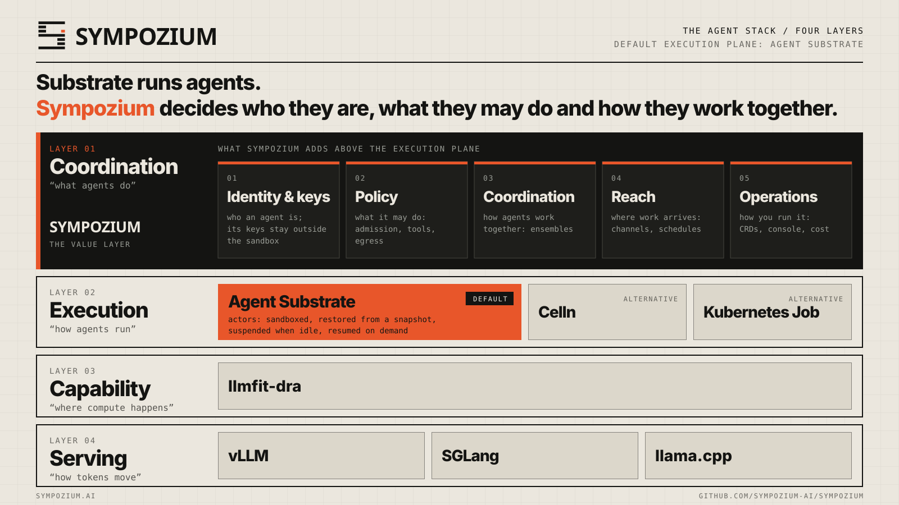
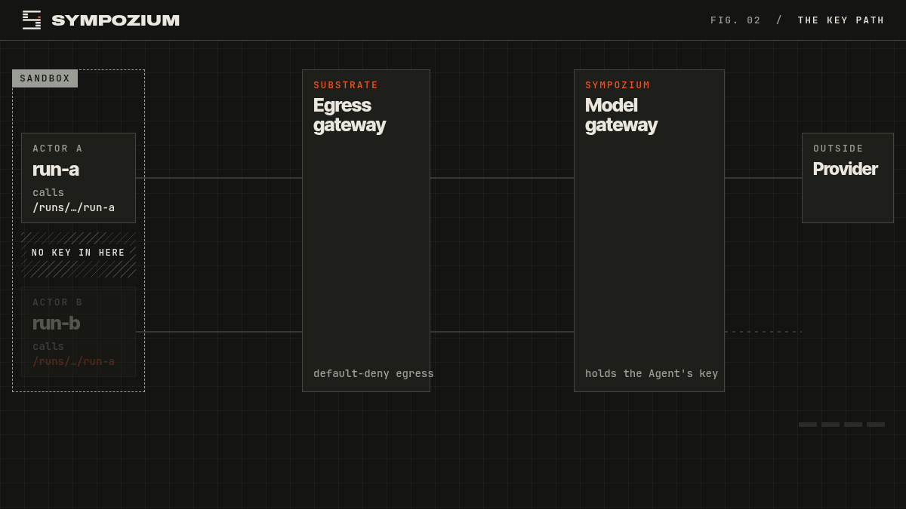
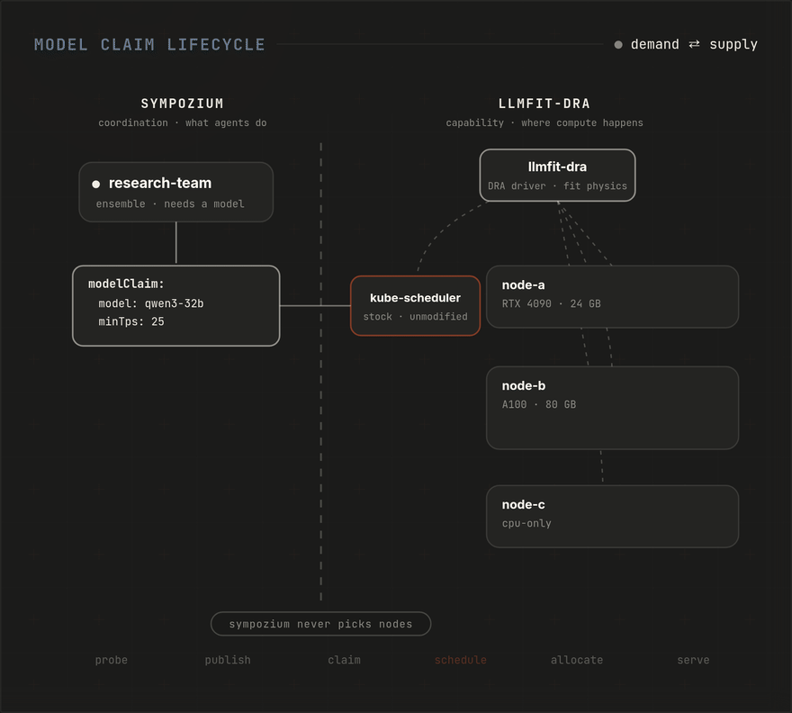

# Positioning: what Sympozium is (and deliberately is not)

Sympozium is a **coordination layer for multi-agent AI systems on Kubernetes**.
It does not run agents itself. It sits above an execution plane, which by
default is [Agent Substrate](https://github.com/agent-substrate/substrate),
and adds what an execution plane does not have: who an agent is, what it is
allowed to do, how agents work together, how people and systems reach them,
and how you operate the whole thing.

That is the whole product. This page exists because AI infrastructure is a
crowded, blurry space, and the fastest way to stay coherent is to write the
boundary down and hold every feature to it.

<!-- STATUS:substrate -->
!!! warning "State of the Substrate backend, 2026-11-24"
    Agent Substrate is the default execution plane by decision of
    2026-11-24. The implementation is on a branch and not released. Where
    Substrate is installed and enabled (chart value `substrate.enabled`), a
    run that names no backend runs as an actor when it can: a one-shot
    string task with a model key, with channel messages and schedules served
    outside the sandbox under the run's tool policy. A run that needs
    skills, MCP servers, memory, delegation or an enduring conversation runs
    as a Kubernetes Job instead, and its `DefaultExecutionPlane` condition
    says why. A plain `sympozium install` does not install Substrate, so
    there every run is a Job. One in-cluster hop, from Substrate's egress
    gateway to the model gateway, is unencrypted. See [Substrate
    backend](concepts/substrate-backend.md).

## The four layers

AI systems on Kubernetes decompose into four layers with four different
jobs. Sympozium is exactly one of them.

<p align="center">
  
</p>

| Layer | Who | Owns | Decides |
|-------|-----|------|---------|
| **Coordination** | Sympozium | Agents: identity and keys, policy, membrane, ensembles, memory, channels, schedules, operations | What agents **do** |
| **Execution** | [Agent Substrate](concepts/substrate-backend.md) by default; [Celln](concepts/celln-backend.md) or a Kubernetes Job as alternatives | The sandbox a run executes in: isolation, start, suspend and resume, egress | How agents **run** |
| **Capability** | [llmfit-dra](https://github.com/sympozium-ai/llmfit-dra) | Accelerator inventory, fit physics, claims, placement | Where compute **happens** |
| **Serving** | vLLM, SGLang, llama.cpp | Batching, KV cache, disaggregation runtime | How tokens **move** |

## The boundary test

For any proposed feature, ask one question: *does it decide what agents do,
how agents run, where compute happens, or how tokens move?*

One question, one home. If the answer is not "what agents do", the feature
belongs in another layer, even if Sympozium could technically host it.

Some examples of the fourth question, the one this page gained on 2026-11-24:

| Proposed feature | Answer | Home |
|---|---|---|
| Suspend an idle agent and restore it on another machine | How agents run | Execution plane |
| A stronger sandbox boundary, or a faster start | How agents run | Execution plane |
| Which Agent may use which model key | What agents do | Sympozium |
| Which tools a run may call | What agents do | Sympozium |
| Which worker or node a run lands on | How agents run | Execution plane |

## What Sympozium adds above an execution plane

An execution plane answers one question well: given a program, run it in
isolation, cheaply, and stop it when told. Agent Substrate does this with
sandboxed actors that start from a memory snapshot and can be suspended when
idle. It deliberately has few opinions beyond that. It does not know what an
Agent is, whose model key a request should carry, which tools are allowed,
or that two runs belong to the same team.

Sympozium is those opinions. In practice that is three kinds of work you
would otherwise do yourself against the execution plane's API:

- **Configuration.** You write one `Agent` resource: its provider, model,
  key, tools, channels and policy. Sympozium turns that into what the plane
  needs (on Substrate: an actor template and its snapshot, an egress policy
  per actor, a key binding at the model gateway). You never call Substrate.
- **Orchestration.** Sympozium admits each run, creates and resumes its
  actor, hands it its turn, validates the result and deletes the actor. A
  schedule, a channel message or another agent's delegation all become runs
  of the same Agents.
- **Features.** Everything an execution plane has no concept of: teams,
  memory, channels, a console, cost.

Grouped by what they give you, there are five.

| | What Sympozium adds | What you would have with the execution plane alone |
|---|---|---|
| **Identity and keys** | An `Agent` is a durable identity that owns its provider, its model and its key. The key is held outside the sandbox and added to each model call by the model gateway, after it has checked that this run belongs to that Agent. | An actor with a name. Nothing says which model key it may use, so the key goes into the sandbox, or you build the mapping yourself. |
| **Policy** | `SympoziumPolicy`, per-tool allow and deny, and admission checks. They are enforced before a run starts and at the gateways, never by the agent itself. | An egress allowlist per actor. No notion of a tool, a policy object, or a refusal you can audit. |
| **Coordination** | Ensembles, delegation between agents, the membrane that controls what they share, and shared memory. | Isolated tasks. An agent that wants a team composes it itself. |
| **Reach** | Chat channels (Slack, Telegram, Discord, WhatsApp), cron schedules, and an OpenAI-compatible API in front of every Agent. | A control API for starting actors. |
| **Operations** | Every resource is a CRD, so your RBAC, namespaces, audit log and GitOps apply unchanged. A web console, a TUI and a CLI. Token usage and estimated cost on every run. | Actors live in the execution plane's own store behind its own API, outside `kubectl` and your RBAC. |

Two of these deserve a longer explanation, because they are where the layers
meet.

### The key never enters the sandbox

Everything inside a sandbox is driven by an LLM, so Sympozium treats it as
hostile: a prompt injection can make an agent print its environment. The
only safe place for a model key is somewhere the agent cannot read.

The execution plane makes that possible, and Sympozium makes it mean
something. Substrate forces everything an actor sends through its egress
gateway, which stamps each request with a short-lived token naming the
actor. Substrate knows the *actor*. Sympozium knows that the actor is a
particular run, that the run belongs to a particular Agent, and that the
Agent owns a particular key pinned to one provider. The model gateway joins
those facts on every call and adds the key after the request has left the
sandbox.

<p align="center">
  
  <br><em>Substrate says which actor is calling. Sympozium says whose key that is.</em>
</p>

The same rule holds on Celln, where the gateway adds the key outside the
cell. The Kubernetes Job is the exception: there the key is injected into
the pod's environment, one allowlisted key at a time.

### Policy is enforced outside the sandbox

A sandbox cannot be trusted to police itself. So every decision is taken
somewhere the agent cannot reach: admission and key authorisation run in the
controller before the backend is asked to start anything, the model gateway
re-checks ownership on every call, and tool allow and deny rules are applied
by the controller, so a denied tool never reaches the agent. A run that is
refused creates nothing on the execution plane at all.

This is also why the execution plane can be swapped. Identity, keys, policy,
ensembles, memory, channels, schedules and attribution all sit above a single
interface (the
[execution backend seam](design/execution-backend-seam.md)), and a backend
only has to start a run, report on it and release it.

## Where Substrate, Celln and the Job fit

All three are **execution backends**. Each decides how an agent's *own* work
is isolated and run, not what the agent may do and not where a model is
served. A run names one with `spec.backend`; an Agent can set a backend for
all its runs.

| | Agent Substrate (default) | Celln | Kubernetes Job |
|---|---|---|---|
| **A run is** | An actor: a gVisor sandbox restored from a memory snapshot | A cell: a KVM microVM | A Pod, optionally under gVisor or Kata through [Agent Sandbox](concepts/agent-sandbox.md) |
| **You install** | Agent Substrate, with its PostgreSQL and object storage | The Celln fleet, on nodes with `/dev/kvm` | Nothing |
| **The Agent's model key** | Never in the sandbox | Never in the cell | In the pod's environment |
| **An idle agent** | Can be suspended to storage, where it holds no process memory | Holds its cell until its lease ends | Holds its Pod |
| **Built and maintained by** | Google and the Substrate community | This project | Kubernetes |

**Why Substrate is the default.** Agents work in bursts and then wait: on a
model, on a tool, on a person. A runtime that can suspend the waiting agent
and start the next one from a snapshot fits that shape, and a Pod per run
does not. In the spike that led to this decision, a one-shot run reached
`Succeeded` in 0.43 s on Substrate against 11.3 s as a Job (median of 20
runs each, one node, a stub model so provider time is excluded, measured
2026-11-22). A suspended actor held no worker process memory and about
0.6 MB of storage. Substrate also has far more people behind it than this
project has, and building a second sandbox runtime is not the best use of
ours. The method and the raw data are in the
[spike results](evidence/substrate-spike-go-no-go-2026-11-22.md).

**Why Celln still exists.** [Celln](concepts/celln-backend.md) is the
self-hosted option. It needs nothing from outside the cluster: no external
control plane, no database, no object store, only nodes with KVM. Each run
gets a hardware boundary (a microVM with its own kernel) rather than a
user-space one. Choose it when you cannot or will not depend on Substrate,
for example on an air-gapped site, or when policy requires hardware
isolation.

**Why the Job still exists.** It needs nothing installed at all, so
Sympozium works on any Kubernetes cluster as soon as it is installed. It
is also the backend that everything in Sympozium has run on longest. Choose
it to try Sympozium, for development, or for workloads where a Pod per run
is acceptable and start latency does not matter.

Placement follows the same rule on all three: Sympozium does not pick the
machine. Substrate assigns an actor to a worker in its pool. The Celln
gateway issues each parent on the owner with the most spare capacity, and a
fleet node joins by carrying the `celln.dev/kvm=true` label. That label is
capability inventory, applied today by node-probe next to its inference
discovery, and the caveat under
[Consequences already scheduled](#consequences-already-scheduled) applies to
it. A Job's Pod is placed by the stock scheduler. Accelerator power from
ergoz is a read-only view of an external collector, in the same way as the
density dashboard.

## Models are claimed, not placed

Agents need model endpoints. Historically Sympozium grew its own placement
machinery to provide them — node telemetry caches, best-node selection,
hostname pinning. That machinery is being retired: placement moves to
[llmfit-dra](https://github.com/sympozium-ai/llmfit-dra), a Kubernetes DRA
driver that publishes what each accelerator *can do* and lets the **stock
kube-scheduler** place workloads against physics ("this model at 20 tok/s"),
with exclusive allocation and explainable failures.

<p align="center">
  
  <br><em>The claim lifecycle: probe → publish → claim → schedule → allocate → serve.
  Sympozium never picks nodes — the claim is the only thing that crosses the boundary.</em>
</p>

The analogy that makes this precise: **a ModelClaim is to llmfit-dra what a
PersistentVolumeClaim is to a CSI driver.** No one calls an application "a
storage product" because its chart contains a `volumeClaimTemplate`. In the
same way, an Ensemble persona declaring

```yaml
modelClaim:
  model: Qwen/Qwen2.5-32B-Instruct
  minTps: 25
```

does not make Sympozium a placement engine. Sympozium governs *whether and
what* an agent may claim (policy, budgets, quotas); the capability layer
decides *whether and where* the claim is satisfiable. Demand and supply,
meeting at the claim.

The execution boundary works the same way. Selecting `backend: substrate`
does not make Sympozium a sandbox runtime, any more than a `modelClaim`
makes it a scheduler.

## What Sympozium is not

- **Not a sandbox runtime.** Sympozium does not build the isolation
  boundary, snapshot memory, or multiplex idle agents onto workers. That is
  the execution plane's job. If all you need is to run isolated tasks at
  very high density and you plan to build identity, policy and coordination
  yourself, use Agent Substrate directly.
- **Not a model-serving platform.** If you want to serve models without
  agents, you don't need Sympozium: use llmfit-dra plus a serving engine
  directly. Sympozium's Model resource exists to give *personas* endpoints,
  not as a general serving product.
- **Not a placement engine.** Sympozium never decides which node or device a
  model runs on, or which worker an agent runs on. It expresses
  requirements; the scheduler or the execution plane satisfies them.
- **Not an inference runtime or gateway.** Disaggregated prefill/decode,
  KV-cache transfer, batching strategy — that is the serving layer's job.
  llmfit-dra places the *pools* (its claims can distinguish prefill-grade
  from decode-grade silicon); the engine moves the tokens; a Sympozium
  persona just sees one endpoint. (Sympozium's model gateway is not an
  inference gateway: it decides whose key a call carries, which is "what
  agents do", and forwards the call unchanged.)

## Consequences already scheduled

Some existing subsystems fail the boundary test and are being migrated, not
grown:

- **node-probe** (host inference discovery) is capability inventory — it
  belongs in the supply layer and will move out of Sympozium.
- **The density dashboard** remains as screens, but post-migration it is a
  read-only view of llmfit-dra's published inventory, not a Sympozium
  subsystem.
- **Celln** is an execution plane that this project also maintains. It
  stays, as the self-hosted alternative, but it is no longer where new
  isolation or density work goes by default.

The full migration map for the first two lives in the llmfit-dra repo
([sympozium-integration design](https://github.com/sympozium-ai/llmfit-dra/tree/main/docs/design)).

## How we got here

On 2026-10-30 the project decided that isolation and density are an
execution plane and that the execution plane is pluggable, with Agent
Substrate to be added as an optional backend and the Job as the default
([epic #692](https://github.com/sympozium-ai/sympozium/issues/692)). A spike
then ran an `AgentRun` as a Substrate actor through the real controller. On
its results the decision of 2026-11-24 went further: Substrate is the
default execution plane, and Sympozium is the value layer above it. See the
[roadmap](roadmap.md) for the work that follows.

## The one-liners

- **Sympozium**: a coordination layer for multi-agent AI systems on
  Kubernetes. Agents run as Agent Substrate actors by default, with each
  Agent's key held outside the sandbox; policy is CRDs — and when an agent
  needs a model, it *claims* one; Sympozium never decides where it runs.
- **Agent Substrate**: the default execution plane — sandboxed actors that
  start from a snapshot and suspend when idle. **Celln** is the self-hosted
  alternative (KVM microVMs, no external dependency); a **Kubernetes Job**
  needs nothing installed.
- **llmfit-dra**: ask for a model instead of a device — capability inventory
  and physics-based placement for heterogeneous accelerators, through the
  stock scheduler.
